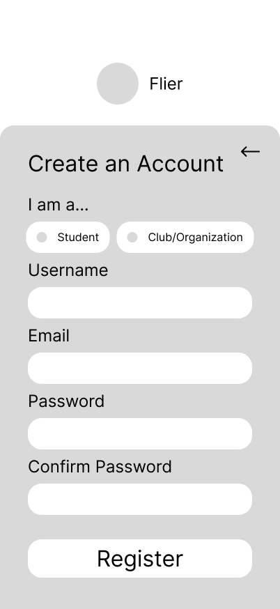
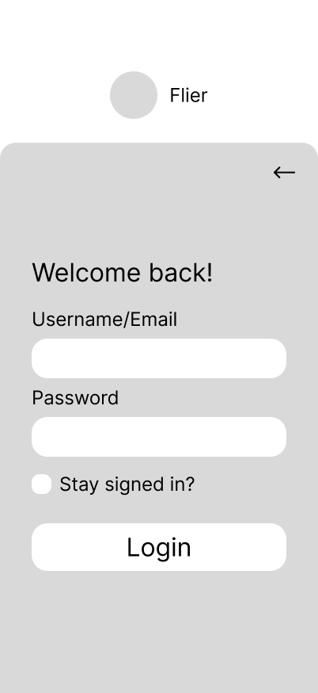
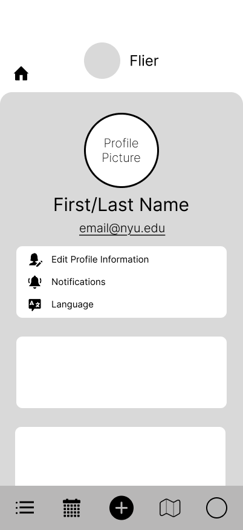

# Flier — User Experience Design

Flier is a mobile web app for finding campus events from flyers. Students browse what is happening today, what is recommended for them, and what was just posted. Clubs and organizations publish flyers with a photo, a date, a time, and a room.

This document starts with the clickable prototype, then the app map, then one wireframe for each screen. Signed-out screens come first. Signed-in screens follow the bottom navigation from left to right.

The wireframes are phone-width layouts. On GitHub they are shown at a readable size; select an image to open it full size.

## Prototype

The prototype is a tappable phone version of these wireframes, built in Figma. It opens in an iPhone frame on the App Landing screen, and the buttons and navigation move between the screens in this document.

[View the Flier prototype](https://www.figma.com/proto/lZiA9kcuE3Aku6BsAnnBWg/Flier---Design?node-id=23-3&p=f&t=3rSDA87xVO3SjH09-1&scaling=scale-down&content-scaling=fixed&page-id=4%3A2&starting-point-node-id=23%3A3)

## App map

The map shows how the screens relate. It does not draw every possible link.

Sign Up and Login sit side by side and both lead into the Main Feed. From the feed, five sections branch out: Organization List, Calendar View, Add Flier, Map View, and Profile.

Add Flier is the only branch with its own children. Posting a flyer continues to an upload form (image, date, time, and room), then to a flier detail screen (image, info, and a Save button).

## Signed-in navigation

Every screen after login shares the same header and bottom bar.

- **Header.** A house icon on the left returns to the Main Feed. The Flier logo sits in the center.
- **Bottom bar, left to right.** Organization List, Calendar View, Add Flier, Map View, and Profile. The icon for the current screen is filled in.

## App Landing

The first screen for someone who is not signed in. It introduces the app and offers the two ways in.

- **Get Started** opens Create an Account.
- **Login** opens the login screen.

## Create an Account

Registration for a new student or a new club. The back arrow returns to the App Landing screen.

- **I am a…** chooses the account type: Student or Club/Organization. One option is selected at a time.
- **Username, Email, Password, and Confirm Password** are required before the account can be created. Confirm Password must match Password.
- **Register** submits the form. A successful registration enters the Main Feed.

## Login

Returning users sign in here. The back arrow returns to the App Landing screen.

- **Username/Email** accepts either the username or the email address from registration.
- **Password** is the account password.
- **Stay signed in?** keeps the session on this device so the person is not asked to log in again on the next visit.
- **Login** submits the form. A successful login enters the Main Feed.

## Main Feed

The home screen after sign-in. It is a stack of sideways-scrolling flyer rows. Each white card is one flyer image. A sliver of the next card stays visible so it is clear the row continues off-screen.

- **Today’s Events** shows flyers for events happening today.
- **For You** shows flyers picked for this user.
- **Newly Added** shows the most recently posted flyers.
- The house icon is the shortcut back to this screen from anywhere else in the app.

## Organization List

A scrollable directory of clubs. The list icon in the bottom bar is the selected tab. Rows continue below the fold.

- Each row is one club: logo, club name, and a short line of club details.
- The search icon filters the directory by club name.

## Calendar View

A month calendar for finding events by date. The calendar icon in the bottom bar is the selected tab.

- The left and right arrows move to the previous or next month.
- The circled date is the selected day. In this example, October 19, 2026 is selected.
- **Today’s Events** under the calendar is the flyer row for the selected day. The cards scroll sideways, the same way they do on the Main Feed.

## Add Flier

Where a club starts a new flyer. The plus icon in the bottom bar is the selected tab. The large crossed box is the image placeholder, and **Add Flier!** begins the post.

The app map continues this screen in two steps that are not drawn as their own wireframes:

1. **Upload form.** The club attaches the flyer image and enters the date, time, and room.
2. **Flier detail.** The club reviews the image and the event info, then taps **Save**.

## Map View

A map of where events are happening. The map icon in the bottom bar is the selected tab.

The white panel is the embedded Google Map, placed here so people can see where events are happening on campus.

## Profile

The signed-in user’s account screen. The circle icon in the bottom bar is the selected tab.

- The circle at the top is the profile photo. Under it are the user’s name and email address.
- **Edit Profile Information** changes the name, email, and photo. **Notifications** controls which alerts the user gets. **Language** sets the app language. Those three rows leave this screen for their own settings, which are not drawn as separate wireframes.
- Two blank panels sit under the settings list. Their contents are unlabeled on this diagram.

